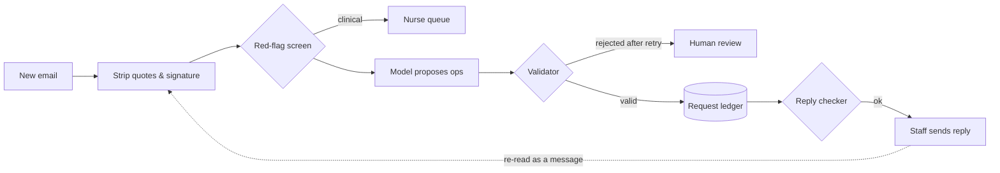

# Clinic Inbox Assistant

**Track every patient request across an email thread, check every AI-proposed change, and stop wrong replies before they're sent.**

[](https://github.com/<you>/clinic-inbox/actions/workflows/tests.yml)
[](https://colab.research.google.com/github/<you>/clinic-inbox/blob/main/notebooks/clinic_inbox_assistant.ipynb)


Patients ask for several things in one email, then change their minds in the next:

> **Email 1:** "Please move my appointment to Friday and send me a copy of my invoice."
> **Email 2:** "Actually, keep my original appointment. I still need the invoice."

Tools that read one message at a time lose the invoice or keep rescheduling. This assistant keeps a **request ledger** for each thread:

| Request | Status | Team | Evidence |
|---|---|---|---|
| Move appointment to Friday | **withdrawn** | Scheduling | "Actually, keep my original appointment." |
| Send invoice | **open** | Billing | "...send me a copy of my invoice." |

If staff then draft *"We've moved your appointment to Friday"*, the reply checker blocks it.


> ⚠️ **Research prototype on fictional data.** No login, encryption or access control. Do not use with real patient information. See [Responsible use](#responsible-use).

## Highlights

- **The model only proposes; the code decides.** The AI suggests typed changes (`CREATE` / `MODIFY` / `WITHDRAW` / `FULFIL`), each quoting the email. Five deterministic rules accept or reject them. Anything unresolved goes to a person.
- **Evidence for every decision.** Each request links to the sentence that created or changed it.
- **Reply checker.** It flags missed requests, confirmations of withdrawn requests, wrong dates and clinical advice before a reply is sent.
- **Clinical safety first.** Clinical content goes to a nurse queue and is never auto-answered.
- **A rigorous evaluation kit.** It includes a synthetic data generator with a held-out split, bootstrap confidence intervals, McNemar tests, ablations, a controlled error-injection study and an inter-annotator agreement toolkit.

## Results at a glance

On 200 held-out synthetic threads with the offline model ([details](docs/EVALUATION.md)):

| Approach | End-to-end F1 [95% CI] | Threads fully right | Open requests missed |
|---|---|---|---|
| **Ledger (this repo)** | **0.797** [0.76, 0.83] | **55.0%** | **15.1%** |
| Latest email only | 0.416 [0.35, 0.48] | 22.5% | 61.4% |

When model errors are injected at a 30% rate, the validator cuts wrong changes applied without a human alert from **0.53 to 0.28 per thread**. It rejects **100%** of hallucinated requests. It can't catch omissions or changes aimed at the wrong valid request, by design.


> These figures come from an offline rule-based extractor and template emails. They validate the pipeline and give a baseline, not real-world accuracy. Real-model and human-written-data results are in progress (see [Roadmap](#roadmap)).

## Quick start

**In the browser (no install):** click **Open in Colab** above, then choose `Runtime → Run all`.

**Locally:**

```bash
git clone https://github.com/<you>/clinic-inbox.git
cd clinic-inbox
python -m venv .venv && source .venv/bin/activate   # Windows: .venv\Scripts\activate
make setup        # or: pip install -r requirements.txt
make test         # 33 tests
make run          # dashboard at http://127.0.0.1:8000 → "Reset & load demo"
```

**With a real model:**

```bash
pip install anthropic                    # or: pip install openai
export LLM_PROVIDER=anthropic            # or: openai
export ANTHROPIC_API_KEY=...             # or: OPENAI_API_KEY=...
make run
```

Copy `.env.example` to `.env` to keep settings. `.env` is git-ignored, so never commit keys.

## How it works



A change is applied only if:
1. its quote appears verbatim in the email
2. only patients create or withdraw requests
3. its target request exists
4. the status change is legal
5. it isn't a duplicate

[Architecture details →](docs/ARCHITECTURE.md)

## Reproduce the experiments

```bash
make all            # regenerate data, benchmark, ablations, error injection, report
```

| Command | Output |
|---|---|
| `make data` | `data/synth_dev.json`, `data/synth_test.json` |
| `make bench` | `results/benchmark_synth_*.json` |
| `make experiments` | `results/ablation.json`, `results/noise.json`, `results/noise.png` |
| `make report` | `results/report.html` |

Human-written test data: see [`annotation/`](annotation/) and `python -m eval.annotation --help`.

## Repository structure

```
clinic-inbox/
├── app/                      # the assistant
│   ├── models.py             # data types: Request, LedgerOp, statuses, categories
│   ├── parsing.py            # quote & signature stripping
│   ├── redflag.py            # clinical content screen
│   ├── llm.py                # mock / Anthropic / OpenAI backends + prompts
│   ├── ledger.py             # validator + applying ops  ← core logic
│   ├── reply_check.py        # reply checker + template acknowledgement
│   ├── routing.py            # category → team
│   ├── service.py            # pipeline, retry/review, staff actions
│   ├── db.py                 # SQLite storage
│   ├── main.py               # FastAPI app
│   └── static/index.html     # staff dashboard
├── eval/                     # evaluation code
│   ├── synth.py              # synthetic thread generator (dev / held-out pools)
│   ├── benchmark.py          # P/R/F1, bootstrap CIs, McNemar
│   ├── experiments.py        # ablations + error injection
│   ├── annotation.py         # inter-annotator agreement, human test sets
│   ├── run_eval.py           # quick check on hand-written threads
│   └── report.py             # HTML report
├── data/                     # demo + synthetic threads (fictional)
├── results/                  # generated results, figures, report
├── annotation/               # writer brief, labelling guide, templates, examples
├── notebooks/                # self-contained Colab notebook
├── docs/                     # architecture, evaluation, API, figures
├── tests/                    # 33 tests
├── .github/workflows/        # CI: tests + benchmark smoke run
├── Makefile · requirements.txt · LICENSE · CITATION.cff
```

## Documentation

- [Architecture](docs/ARCHITECTURE.md): pipeline, validator rules, reply checker, data model
- [Evaluation](docs/EVALUATION.md): data, metrics, statistics, all results, limitations
- [API](docs/API.md): HTTP endpoints
- [Annotation guide](annotation/LABELLING_GUIDE.md): how to build an independent test set

## Roadmap

- [x] Validated request ledger, reply checker, staff dashboard
- [x] Synthetic benchmark with held-out split, ablations, error injection
- [ ] Real-model benchmark (Claude / GPT) including a whole-thread baseline, with cost and latency
- [ ] ~150 independently written, double-labelled threads (Singlish, typos, implied requests)
- [ ] Gmail test-inbox connector
- [ ] Scheduling adapter with `accepted / completed / failed` write states
- [ ] Auth, roles, audit view; PostgreSQL

## Responsible use

This is administrative-workflow software and must not give clinical advice. Before any use with real patient data:
- add authentication, access control and encryption
- agree data handling with the clinic under Singapore's PDPA
- check where your AI provider processes and keeps data
- replace the red-flag list with the clinic's own escalation rules
- keep staff approval on every outgoing message

If the scope ever extends to clinical prioritisation, review MOH's AIHGle 2.0 and HSA software medical-device guidance.

## Citation

If you use this work, please cite it using [`CITATION.cff`](CITATION.cff) (GitHub shows a "Cite this repository" button).

## License

[MIT](LICENSE)
