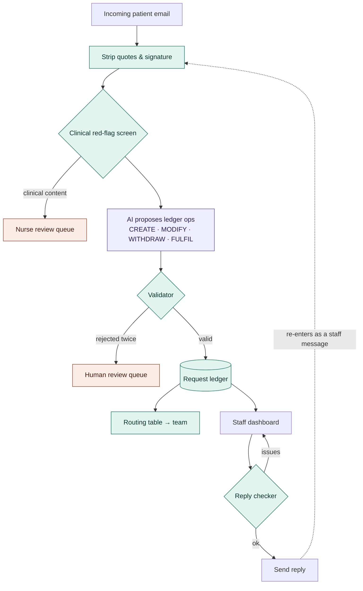

# Clinic Inbox Assistant

**Turns outpatient clinic emails into tracked, routed requests, and checks staff replies before they go out.**


Patients often ask for several things in one email, then change their minds in the next:

> **Email 1:** "Please move my appointment to Friday and send me a copy of my invoice."
> **Email 2:** "Actually, keep my original appointment. I still need the invoice."

Most inbox tools read one message at a time, so the reschedule request either lingers as stale work or the invoice gets lost. This assistant keeps a **request ledger** for each thread instead:

| Request | Status | Team | Evidence |
|---|---|---|---|
| Move appointment to Friday | **withdrawn** | Scheduling | "Actually, keep my original appointment." |
| Send invoice | **open** | Billing | "...send me a copy of my invoice." |

If a staff member then drafts *"We've moved your appointment to Friday"*, the reply checker blocks it, because the patient withdrew that request.


> ⚠️ **Prototype on fictional data.** No login, encryption or access control yet. Do not use with real patient information. See [Before a pilot](#before-a-pilot).

---

## Features

- **Request ledger per thread.** Every patient request is tracked as `open`, `withdrawn`, `fulfilled` or `needs_review`, with full history.
- **Evidence for every decision.** Each request links to the exact sentence that created or changed it, highlighted in the email.
- **Deterministic validator.** The AI only *proposes* changes, and plain code accepts or rejects each one (rules below).
- **Retry, then human review.** A rejected change gets one retry with the validator's feedback. If it fails again it goes to a review queue and is never silently dropped.
- **Clinical red-flag screen.** Symptoms, medication questions and urgent signs go to a nurse queue and are never auto-answered.
- **Reply checker.** Before sending, it flags:
  - open requests the reply ignores
  - replies that act on withdrawn requests
  - wrong dates
  - anything that reads like clinical advice
- **Closing the loop.** A staff reply such as "attached is your invoice" marks the matching request fulfilled.
- **Staff corrections are logged.** Overrides of status, category or owner become evaluation and training data.
- **Team task board.** Open work grouped by Scheduling, Billing, Medical Records, Front Desk and Clinical.
- **Pluggable AI.** Runs offline with no key, or with Claude or GPT.

## Architecture



**Design principle: the model reads language, the code makes decisions.** The language model is used in one place: turning a new message into proposed ledger operations. Validation, routing, state transitions and reply checks are ordinary, testable code.

### Validator rules

Every operation the model proposes must pass all of these before the ledger changes:

1. **Evidence is verbatim.** The quoted sentence must appear in the new message, ignoring case and whitespace.
2. **Only patients create or withdraw.** Staff messages can only fulfil.
3. **The target exists.** `MODIFY`, `WITHDRAW` and `FULFIL` must reference a real request in this thread.
4. **Transitions are legal.** For example, a withdrawn request can't be fulfilled, and a fulfilled request is never silently reopened.
5. **No duplicates.** A `CREATE` that matches an existing open request is rejected.

This follows the *propose, then validate deterministically* pattern from recent dialogue-state-tracking research. Most model errors are local (a wrong ID, an invented quote) and can be caught without understanding the language.

## Quick start

```bash
git clone https://github.com/<you>/clinic-inbox.git
cd clinic-inbox
python -m venv .venv && source .venv/bin/activate      # Windows: .venv\Scripts\activate
pip install -r requirements.txt
uvicorn app.main:app --reload
```

Open <http://127.0.0.1:8000> and click **Load demo threads**. API docs are at <http://127.0.0.1:8000/docs>.

### Choosing the AI backend

| `LLM_PROVIDER` | Needs | Notes |
|---|---|---|
| `mock` *(default)* | nothing | Offline pattern matcher. Free and deterministic, used by the tests. Not a real language model. |
| `anthropic` | `ANTHROPIC_API_KEY`, `pip install anthropic` | Model set by `ANTHROPIC_MODEL` |
| `openai` | `OPENAI_API_KEY`, `pip install openai` | Model set by `OPENAI_MODEL` |

Copy `.env.example` to `.env` and fill it in. `.env` is git-ignored, so never commit keys.

Set `AUDIT=1` to also re-read the whole thread after each message and flag any disagreement with the ledger. This costs extra model calls.

## Evaluation

The repo includes a synthetic data generator and a statistical benchmark:

```bash
python -m eval.synth --n 200 --pool dev  --seed 11 --out data/synth_dev.json
python -m eval.synth --n 200 --pool test --seed 22 --out data/synth_test.json
python -m eval.benchmark --data data/synth_test.json      # add --limit 100 with a paid model
python -m eval.report                                      # writes eval/report.html
```

The generator builds threads from scenarios: multiple requests, withdrawals, date changes, staff completions, receipt confirmations, restatements and thanks-only replies. It adds quoted text and signatures as noise. Labels are exact by construction.

There are two independent **phrasing pools**:
- **dev**: phrasings visible during development
- **test**: held-out phrasings that are never used to tune the system

### Results: held-out pool, offline mock model

200 threads · 408 emails · 432 gold requests · 95% bootstrap CIs (2,000 resamples)

| Approach | End-to-end F1 | Precision | Recall | Macro F1 | Thread accuracy | Missed open requests |
|---|---|---|---|---|---|---|
| **Ledger (this app)** | **0.797** [0.76, 0.83] | 0.841 | 0.757 | 0.815 | **55.0%** | **15.1%** |
| Latest email only | 0.416 [0.35, 0.48] | 0.696 | 0.296 | 0.462 | 22.5% | 61.4% |

- **Paired difference in end-to-end F1:** +0.38 (95% CI +0.33 to +0.44).
- **Thread accuracy (exact McNemar test):** the ledger was right on 65 threads where the baseline was wrong, and never the reverse (p ≈ 5×10⁻²⁰).
- **Reply checker** (scored against the correct ledger): stops bad replies with F1 0.96, with 21 false alarms out of 200 correct replies.
- **Known weakness:** withdrawals in unfamiliar wording. 52% of closed requests still showed as open.
- **Unseen wording:** F1 drops from 0.975 on dev phrasings to 0.797 on held-out ones.

> **How to read these numbers:** they come from the offline pattern matcher, not a language model, and template emails are cleaner than real patient writing. They show the evaluation pipeline works and give a baseline. They are not an estimate of real-world accuracy. Run the benchmark with a real model, ideally on threads written by someone else, before quoting results.

**Metrics:**
- **End-to-end F1:** a request counts as correct only when its category, key detail (date or document) and final status all match.
- **Find F1:** the same match, ignoring status.
- **Thread accuracy:** the whole final list is right.
- **Missed-open rate:** requests the patient still needs that aren't shown as open.
- **Stale rate:** withdrawn or completed requests still shown as open.

## Project structure

```
app/
├── models.py          # Message, Request, LedgerOp, statuses, categories
├── parsing.py         # quote & signature stripping
├── redflag.py         # clinical content screen (replace with the clinic's agreed list)
├── llm.py             # mock / Anthropic / OpenAI backends + prompts
├── ledger.py          # validator + applying ops  ← core logic
├── reply_check.py     # reply coverage & consistency checks, template acknowledgement
├── routing.py         # category → team table
├── service.py         # pipeline orchestration, staff actions, views
├── db.py              # SQLite storage
├── main.py            # FastAPI app
└── static/index.html  # staff dashboard
data/
├── threads.json       # 15 hand-written labelled threads
├── synth_dev.json     # generated, dev phrasings
└── synth_test.json    # generated, held-out phrasings
eval/
├── run_eval.py        # quick comparison on hand-written threads
├── synth.py           # synthetic thread generator
├── benchmark.py       # P/R/F1, bootstrap CIs, McNemar
└── report.py          # HTML report
tests/test_core.py     # 21 tests
```

## API

| Method | Endpoint | Purpose |
|---|---|---|
| `POST` | `/api/threads` | Create a thread from the first patient email |
| `POST` | `/api/threads/{id}/messages` | Add an incoming message (`sender`: `patient` / `staff`) |
| `GET` | `/api/threads/{id}` | Messages, ledger, review items, flags |
| `GET` | `/api/threads/{id}/draft` | Template acknowledgement for open requests |
| `POST` | `/api/threads/{id}/check-reply` | Run the reply checker |
| `POST` | `/api/threads/{id}/reply` | Check, then send (blocked unless `override: true`, which is logged) |
| `PATCH` | `/api/requests/{id}` | Staff correction: status, owner or category |
| `GET` | `/api/inbox` · `/api/board` | Inbox list · open work by team |

## Testing

```bash
pytest -q
```

The tests cover:
- quote stripping
- red-flag levels
- each validator rule
- retry and review-queue behaviour
- parsing of real model output
- every reply-checker issue
- staff corrections
- an end-to-end API flow

## Roadmap

- [ ] Benchmark with Claude / GPT, including the whole-thread baseline
- [ ] Independently written test threads, including Singlish and mixed-language emails
- [ ] Gmail test-inbox connector (push notifications, watch renewal, deduplication)
- [ ] Mock scheduling adapter with `accepted / completed / failed` write states
- [ ] Staff login, roles and audit view
- [ ] PostgreSQL and a job queue for production

## Before a pilot

This is administrative-workflow software and must not give clinical advice. Before using it with real patient data:

- Add authentication, role-based access and encryption at rest.
- Agree data handling with the clinic under Singapore's **PDPA**.
- Confirm where your AI provider processes and stores data, and its retention terms.
- Replace `app/redflag.py` with the clinic's own escalation wording and path.
- Keep staff approval on every outgoing message.
- If the scope ever extends to clinical prioritisation or advice, review **MOH AIHGle 2.0** and HSA software medical-device guidance.

## License

Add a license of your choice (e.g. MIT) before publishing.
